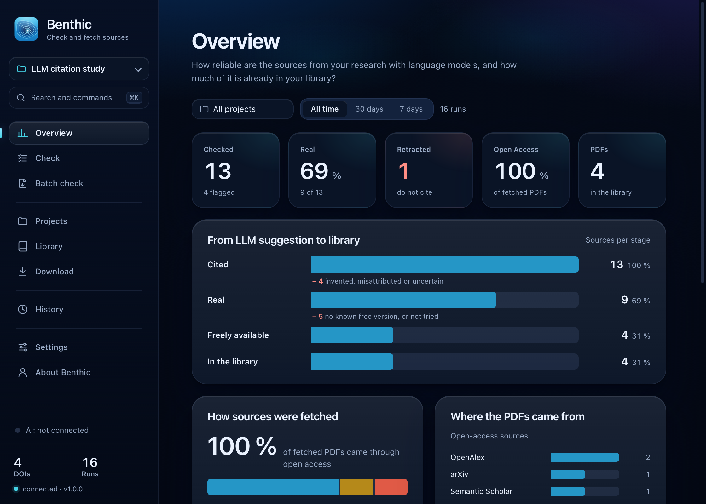
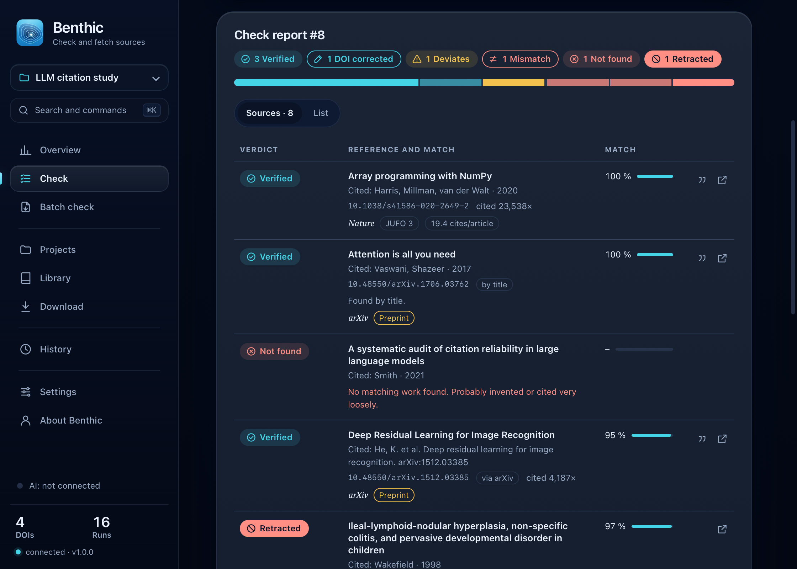
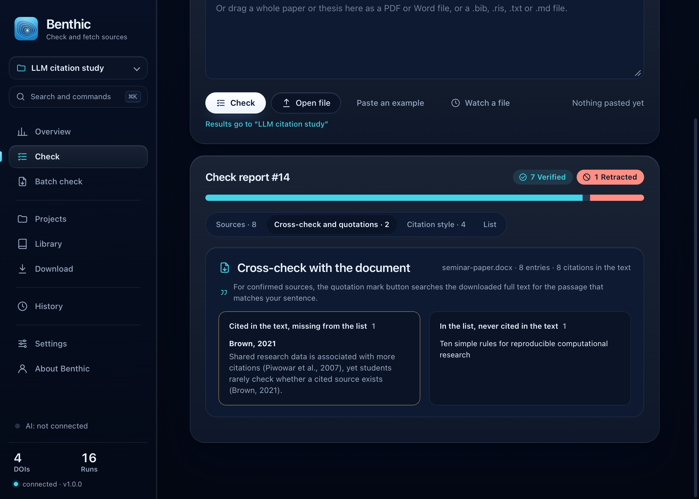
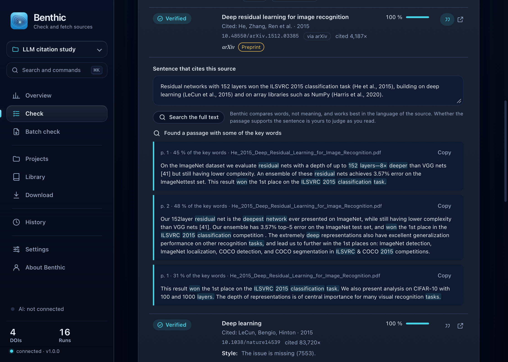
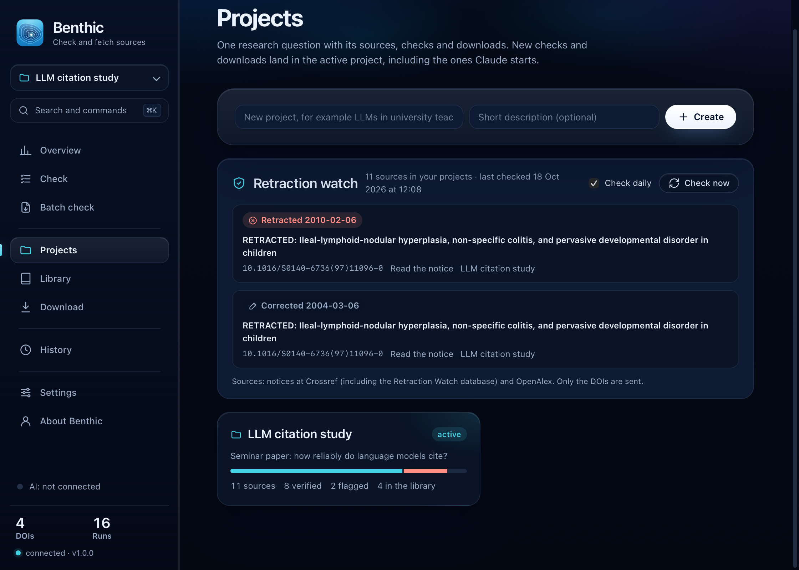
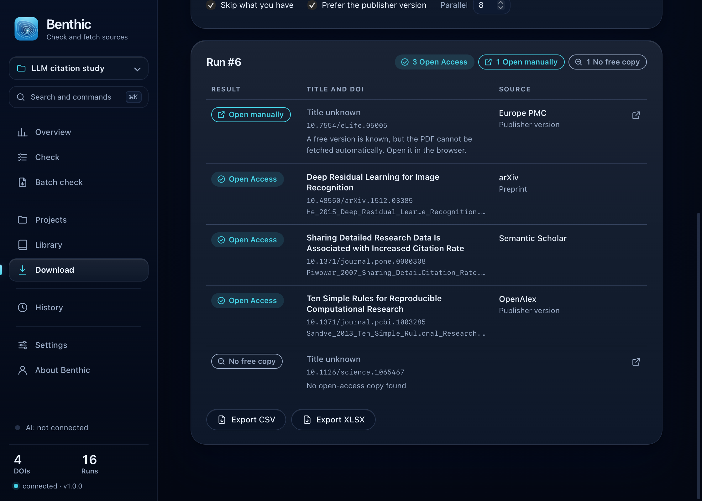
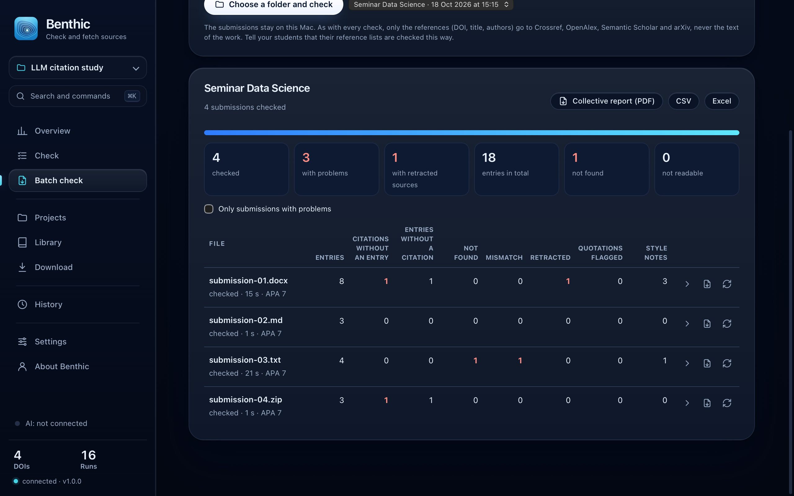
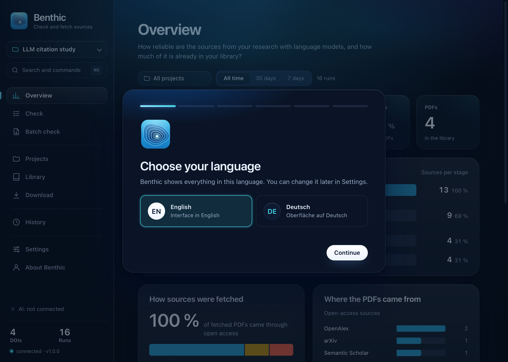
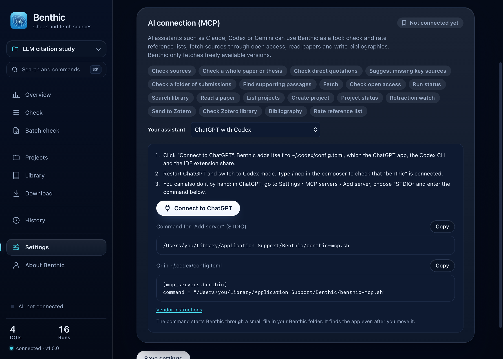

<p align="center">
  <picture>
    <source media="(prefers-color-scheme: dark)" srcset="macos/design/Lockup-dark.svg">
    
  </picture>
</p>

<p align="center"><strong>Check every reference. Fetch the real ones.</strong></p>

<p align="center">Developed by <a href="https://isoglu.com">Sinan Isoglu</a> · AGPL-3.0</p>

<p align="center"><a href="https://benthic.isoglu.com/">Product page</a> · <a href="https://benthic.isoglu.com/download/">Download</a> · <a href="https://benthic.isoglu.com/roadmap/">Roadmap and ideas</a> · <a href="https://benthic.isoglu.com/blog/">Blog</a> · <a href="CHANGELOG.md">Changelog</a></p>

Language models cite dozens of sources in seconds, but some are invented, some
were retracted, and nearly all still have to be found. Benthic sits in between:
paste a reading list (an LLM answer, BibTeX, RIS, Markdown or plain DOIs), let
Benthic check every source, and download the real ones from open-access sources. It
runs as a native macOS app, as a local web interface and as a tool for Claude
and other AI clients (MCP).

For every DOI, Benthic first checks your own library, then eight open-access
sources. If no open-access copy exists, it offers your university library's
proxy link instead.

The interface is in English or German: the first launch asks, and Settings
switches it at any time. Everything runs locally on your Mac; Benthic only
talks to the scholarly services listed below.



## Features

- **Reference check (hallucination check).** Paste anything, Benthic finds the
  references and identifiers (DOI, arXiv, PMID) and checks each one: does it
  exist, does it match the citation (title, year, authors), is the DOI wrong or
  missing (Benthic finds the right one), and was the paper retracted.
- **Whole theses.** Drop a PDF or Word file. Benthic reads the bibliography,
  checks every entry and compares the list with the citations in the text: works
  cited but missing from the list, and entries never cited.
- **Citation style.** Which style the list follows (APA 7, Harvard, Chicago,
  IEEE, Vancouver, DIN 1505), which entries break it and which fields are
  missing, with a correct version of each entry in the style you choose.
- **LaTeX projects.** A `.tex` file with its `.bib` files (or the whole project
  as a `.zip` or folder): `\cite` keys missing from the `.bib`, `.bib` entries
  never cited, and every cited entry verified.
- **Quote check.** Every direct quotation in a thesis is looked up word for word
  in the downloaded full text of its source: found, wording differs (with the
  source's wording) or not found, and whether the cited page is right, also
  for journal page numbers.
- **Find the passage.** For a confirmed source, Benthic searches the
  downloaded full text for the passages closest to the sentence that cites it,
  with page numbers. It ranks by wording; whether a passage supports the claim
  is for you (or your assistant) to judge as you read. When the sentence and the
  source are in different languages, the app translates the sentence on the Mac
  first (Apple Translation, macOS 15 or later).
- **Preprint to published version.** Confirmed arXiv, bioRxiv, SSRN and other
  preprints that have since appeared in a journal or proceedings are flagged,
  with the published reference to copy.
- **Key papers you may be missing.** Works that your confirmed sources cite
  again and again but that are not in your list (OpenAlex, or Crossref's open
  reference lists).
- **PDF report.** One report per check (verdicts, cross-check, quotations,
  published versions, style notes, key papers) to save as a paginated PDF.
- **Watch a file.** Benthic rechecks a Word, PDF or LaTeX file whenever you
  save it, if its references or citations changed, and reports new problems.
- **Batch check for lecturers.** A folder of submissions (with subfolders,
  optional quotation checks and a project per batch), every file listed with
  its state and time remaining, totals, a problems filter, the problems of each
  file, a report per submission and a collective PDF report, export as CSV or
  Excel. The submissions stay on the Mac; only the references are looked up.
- **Checks per project.** Check a project's sources again, run the retraction
  watch for one project, switch it off per project, and see each project's runs.
- **Usage and limits.** Every request to every service is counted; Benthic
  keeps to their limits, waits through short pauses, skips a service whose daily
  allowance is used up, and never reports a source as missing because a
  database did not answer. Settings shows today's requests, what is left and a
  log without e-mail addresses or keys. Each report row shows which sources were
  asked and what they found.
- **Retraction watch.** Once a day Benthic rechecks every source in your
  projects (Crossref notices, including the Retraction Watch database, and
  OpenAlex) and tells you about retractions, expressions of concern and
  corrections.
- **Zotero both ways.** Send confirmed sources to the collection open in Zotero
  (through Zotero's local connector) and check your whole Zotero library for
  retracted papers (read from a copy of its database; Zotero is never changed).
- **Questionable journals.** Journals that DOAJ removed for not adhering to best
  practice, or that falsely claim to be in DOAJ, are flagged in the list health
  (DOAJ lists, CC BY-SA 4.0 and CC0, loaded weekly). An optional check, off by
  default, recognises hijacked journal websites from the Retraction Watch
  Hijacked Journal Checker.
- **Send from any app.** Select references anywhere and use Services › Check
  References with Benthic, the bookmarklet in your browser, or a
  `benthic://check?text=…` link.
- **Open-access downloads.** Library first, then arXiv, OpenAlex, Unpaywall, Europe
  PMC, Semantic Scholar, CORE, publisher APIs (Elsevier with your own key) and
  Crossref. If a free copy is known but cannot be fetched automatically, Benthic
  says so and links to it. Otherwise, it offers your library proxy link.
- **Learning library.** A growing DOI index with import from Zotero (read from
  a copy, Zotero may stay open), BibTeX, RIS, Markdown or text. Known DOIs are
  skipped automatically.
- **Projects.** Sources per research question with verdict and PDF status,
  "fetch missing" in one click, and bibliographies as BibTeX, RIS or formatted
  (APA, Harvard, Chicago, IEEE, DIN 1505).
- **Overview.** Key figures, the funnel from "cited" to "in your library",
  where PDFs came from, verdicts and flagged sources, per project and period.
- **Live dive.** During a run every source sinks as deep as it needs to, from
  the surface (your library) through the open-access sources.
- **Reference list health.** For a project or a check report: are the sources
  real, how old are they (median age, age distribution, share from the last five
  years), where were they published (journal or preprint, citations per article
  from OpenAlex, the Finnish JUFO level, ranks from ranking lists you import
  yourself, such as VHB-JOURQUAL, ABDC, AJG or an SJR export) and how many PDFs
  you already have. Benthic ships no ranking lists; their publishers' terms apply.
- **MCP server.** Nineteen tools for AI assistants: Claude Desktop, ChatGPT with
  Codex, Antigravity, Claude Code, Codex CLI, Gemini CLI, Grok Build, Cursor,
  LM Studio and VS Code. Most connect in one click from the settings, or with one
  command from the assistant itself. Runs an assistant starts appear live in the app.
- **Native macOS app.** Swift and WKWebView, universal for Apple Silicon and
  Intel (macOS 13 or later), with the Python backend bundled: no Python needed
  on the target Mac. Command palette (`⌘K`), dark mode, notifications, export
  to CSV and XLSX, history of the last 50 runs, updates in one click.



| Whole thesis: cross-check and citation style | The passage behind a citation |
|---|---|
|  |  |

| Retraction watch | Download results (dark mode) |
|---|---|
|  |  |



| Verdict | In German | Meaning |
|---|---|---|
| Verified | Bestätigt | The source exists and matches the citation |
| DOI corrected | DOI korrigiert | The source exists; the given DOI was wrong or missing |
| Deviates | Weicht ab | The source exists, but year, title or authors differ |
| Uncertain | Unsicher | A similar match; please check yourself |
| Mismatch | Passt nicht | The DOI belongs to a different work |
| Not found | Nicht auffindbar | No matching work found, probably invented |
| Retracted | Zurückgezogen | The paper was retracted |

## Install

Download the latest Benthic for macOS from the
[download page](https://benthic.isoglu.com/download/): one disk image
for Apple Silicon and Intel, macOS 13 or later. Open it and drag Benthic into
Applications. Versions for Windows and Linux are planned.

Benthic is free and not notarised by Apple, because notarisation needs a paid
Apple Developer account. macOS therefore blocks the first launch: open
**System Settings → Privacy & Security**, scroll down to the message about
Benthic, click **Open Anyway** and confirm. You do this once: updates from
inside the app (version 1.3 and later) need no new approval. The download page
lists the SHA-256 checksum of every release
(`shasum -a 256 ~/Downloads/Benthic-*.dmg`), and you can always
[build Benthic from source](#build-from-source).

Benthic tells you when a new version is out and, from version 1.3, installs it
in one click: it downloads the disk image from benthic.isoglu.com, checks its
SHA-256 against the release manifest and the app's signature, replaces itself
and restarts. If it cannot replace itself where it is (for example outside
Applications without write access), it opens the update in the Finder instead.
What changed is in [CHANGELOG.md](CHANGELOG.md).

On first launch a short assistant asks for your language, your name and e-mail address (sent
to Unpaywall and Crossref as their etiquette asks), your university and its
proxy (EZproxy or OpenAthens), a download folder (default `~/Documents/Benthic`)
and an existing library to import.



## Connect your AI assistant (MCP)

Benthic's tools run on your Mac, so the app has to be installed. Then either
let the app connect your assistant, or install Benthic from the assistant.

### From the app

Open **Settings → AI connection** and pick your assistant:

| Assistant | What Benthic does |
|---|---|
| Claude Desktop | One click: Benthic writes `Benthic.mcpb` and Claude Desktop shows its install dialog |
| ChatGPT with Codex, Antigravity, Gemini CLI | One click: Benthic adds its entry to that program's configuration (`~/.codex/config.toml`, `~/.gemini/config/mcp_config.json`, `~/.gemini/settings.json`) and keeps a backup next to the file |
| Cursor, VS Code, LM Studio | One click opens that program's own install dialog |
| Claude Code, Codex CLI | A terminal command (`claude mcp add`, `codex mcp add`) |
| Grok Build | The command to register as a stdio server |
| ChatGPT, Gemini or Grok in the browser | A prompt for a clean source list to paste into Benthic; browser chats cannot start tools on your Mac |

These entries point to one launcher, `benthic-mcp.sh` in Benthic's data folder, which
sets the environment of this installation and finds the app again if it was moved.

### From your assistant

This repository is also a plugin marketplace. One command installs Benthic's
tools, plus a short skill that tells the assistant when to check references:

```bash
# Claude Code
claude plugin marketplace add isoglu/benthic && claude plugin install benthic@benthic

# Codex (CLI and the ChatGPT app)
codex plugin marketplace add isoglu/benthic && codex plugin add benthic@benthic

# Gemini CLI
gemini extensions install https://github.com/isoglu/benthic
```

In VS Code, run **Chat: Install Plugin From Source** with
`https://github.com/isoglu/benthic`. Any other assistant can start the fixed
command every installation carries:

```bash
claude mcp add benthic --scope user -- /Applications/Benthic.app/Contents/Resources/bin/benthic-mcp
codex mcp add benthic -- /Applications/Benthic.app/Contents/Resources/bin/benthic-mcp
```

The plugins find the app in `/Applications`, `~/Applications` or through
Spotlight; their files come from `scripts/make_plugins.py`.

| Tool | What the assistant does with it |
|---|---|
| `verify_references` | Check a reading list (invented, wrong DOI, retracted) |
| `fetch_papers` | Download real sources as open access into the library |
| `check_open_access` | Check without downloading whether an open-access copy exists |
| `get_fulltext` | Read a downloaded paper, page by page |
| `search_library` | Search the library, also per project |
| `create_project`, `list_projects`, `project_status` | Manage projects |
| `export_bibliography` | Bibliography as BibTeX, RIS or APA, Harvard, IEEE, DIN and more |
| `assess_references` | Health of a reference list: authenticity, age, venues, journal metrics |
| `get_job` | Collect the results of a job that is still running |

If the app is not running, the MCP server starts the backend itself and stops
it again with the assistant.



## Network and privacy

Benthic has no account, no telemetry and no server of its own. Settings, library,
history and downloads stay in `~/Library/Application Support/Benthic` and your
download folder. To check and fetch sources it calls these public services:
doi.org, Crossref, OpenAlex, arXiv, Unpaywall, Europe PMC, Semantic Scholar,
CORE and, with your key, Elsevier, plus the repositories and publishers where
these services say a PDF is hosted. For journal levels it asks the Finnish
Publication Forum (jufo-rest.csc.fi); you can turn that off in the settings. If an update address is set, it also reads
a small release manifest (JSON) from there and, when you update, downloads the
new disk image from the same server.

To confirm references without a DOI (magazine articles, chapters, books) it
also asks Semantic Scholar and Open Library by title and author.

The retraction watch sends the DOIs of your project sources to Crossref and
OpenAlex once a day (off in Projects, also per project). The DOAJ lists and, if you turn it on,
the Retraction Watch Hijacked Journal Checker are downloaded from Google Sheets
at most once a week; nothing about you is sent. Zotero is reached only on
127.0.0.1. OpenAlex gives every network a small free daily budget; with your
own free API key (Settings › Contact and access) large lists run without that
limit.

## Build from source

Requirements: macOS 13 or later, Xcode Command Line Tools (for `swiftc`) and
[uv](https://docs.astral.sh/uv/).

```bash
git clone https://github.com/isoglu/benthic.git
cd benthic
uv venv .venv
uv pip install --python .venv/bin/python -r requirements.txt
```

Run the web interface and open <http://127.0.0.1:8327>:

```bash
.venv/bin/python run.py
```

Build the native app (universal by default, `--native` for this Mac only):

```bash
./macos/build_app.sh
open dist/Benthic.app
```

The build downloads a standalone CPython through uv, installs the dependencies
into the bundle, checks that each of them is listed in
[THIRD_PARTY_NOTICES.md](THIRD_PARTY_NOTICES.md), precompiles the bytecode and
signs the app ad hoc. `./macos/make_dmg.sh` then packs `dist/Benthic-<version>.dmg`.

### Tests and checks

```bash
.venv/bin/python -m unittest discover -s tests -t .
./scripts/trace_check.sh                 # source tree
./scripts/trace_check.sh dist/Benthic.app  # built app
```

`trace_check.sh` keeps private paths, personal addresses and a list of
unwanted terms out of the repository, including image metadata and the source
paths inside compiled bytecode.

## Extending Benthic

A plugin can add download routes that run after open access, only when the
user switches them on; AI tools never use them. Plugins are bundled at build
time (`./macos/build_app.sh --plugin=DIR`) and are never loaded from a folder
the user can write to. See [docs/extending.md](docs/extending.md).

## Releasing

Official releases are signed ad hoc and not notarised. A release is:

```bash
./macos/build_app.sh
./macos/make_dmg.sh
./macos/make_release.sh      # dist/release.json, notes from both changelogs
```

Before that, a new version number goes into `benthic/__init__.py`,
`macos/Info.plist` and a new section at the top of both changelogs, and
`python3 scripts/make_plugins.py` carries it into the plugin files. A unit test
checks that all of them agree.

With an Apple Developer ID, `./macos/sign_and_notarize.sh` signs the app with
the hardened runtime, notarises app and DMG and staples the tickets. It needs:

```bash
export BENTHIC_SIGN_IDENTITY="Developer ID Application: Your Name (TEAMID)"
export BENTHIC_NOTARY_PROFILE="benthic-notary"   # from: xcrun notarytool store-credentials
```

`--dry-run` signs ad hoc with the hardened runtime and builds the DMG without
uploading anything. The script refuses builds that contain plugins or carry a
different bundle identifier, and runs `trace_check.sh` on the bundle first.

## Project layout

```
run.py                  entry point for the web interface
benthic/app.py            Flask backend: jobs, settings, projects, export, MCP info
benthic/fetcher.py        download cascade: library, open access, extra routes
benthic/oa.py             open-access resolver (eight sources)
benthic/verify.py         reference check
benthic/document.py       whole theses: bibliography, citations, cross-check, quotations
benthic/latex.py          LaTeX projects: \cite keys, .bib entries
benthic/quotes.py         direct quotations against the full text
benthic/preprints.py      published versions of preprints
benthic/related.py        works your sources cite often
benthic/report.py         printable check report
benthic/watchfile.py      watch a thesis while writing
benthic/batch.py          batch check of a folder of submissions
benthic/quota.py          request counting, limits and the request log
benthic/style.py          citation style check
benthic/support.py        passages in a full text that come closest to a claim
benthic/watch.py          retraction watch for project sources
benthic/zotero.py         Zotero: send through the connector, scan the library
benthic/questionable.py   DOAJ lists and hijacked journal websites
benthic/refs.py           reference parser (LLM answers, BibTeX, RIS, Markdown)
benthic/routes.py         extension point for plugin routes
benthic/mcp_server.py     MCP server (standard library only)
benthic/connect.py        setup for AI assistants, one-click configuration entries
benthic/i18n.py           English and German (catalogue in benthic/locales/en.json)
benthic/static/           interface (HTML, CSS tokens, JavaScript)
skills/, .claude-plugin/,   plugins for Claude Code, Codex, VS Code and Gemini CLI
.codex-plugin/, .agents/
macos/                  Swift shell, build, DMG, signing and design assets
tests/                  unit tests (offline)
scripts/                trace check and notices generator
```

## Roadmap, ideas and support

What is planned, and which ideas have the most votes, is on the
[roadmap page](https://benthic.isoglu.com/roadmap/). Ideas are GitHub
issues with the `idea` label: open one with the **Idea** form and vote with 👍
or 👎. Bugs go in a **Bug report**. Outside code contributions are not
accepted for now; see [CONTRIBUTING.md](CONTRIBUTING.md).

## Licence

Copyright © 2026 Sinan Isoglu.

Benthic is free software under the
[GNU Affero General Public License, version 3](LICENSE) (AGPL-3.0-only): you
may use, study, change and share it. Anyone who distributes Benthic, or runs
a modified version as a network service, has to make the complete source of
their version available under the same licence. If the AGPL does not fit your use, for example
inside a closed product or service, ask about other licensing terms through
[isoglu.com](https://isoglu.com).

The app bundles CPython and several open-source libraries under their own
licences, listed in [THIRD_PARTY_NOTICES.md](THIRD_PARTY_NOTICES.md) and shown
in the app under **About Benthic** and **Settings → Updates → Licences and
notices**.
